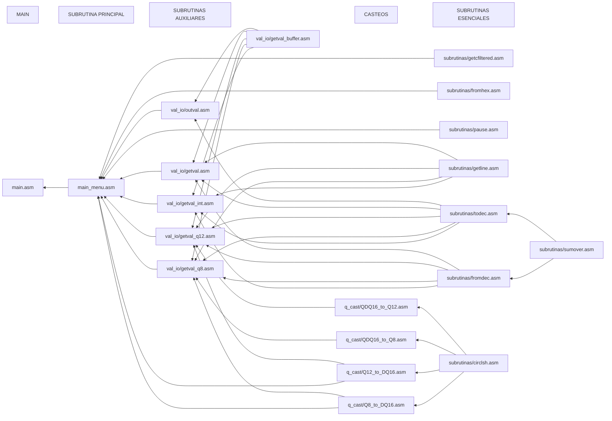
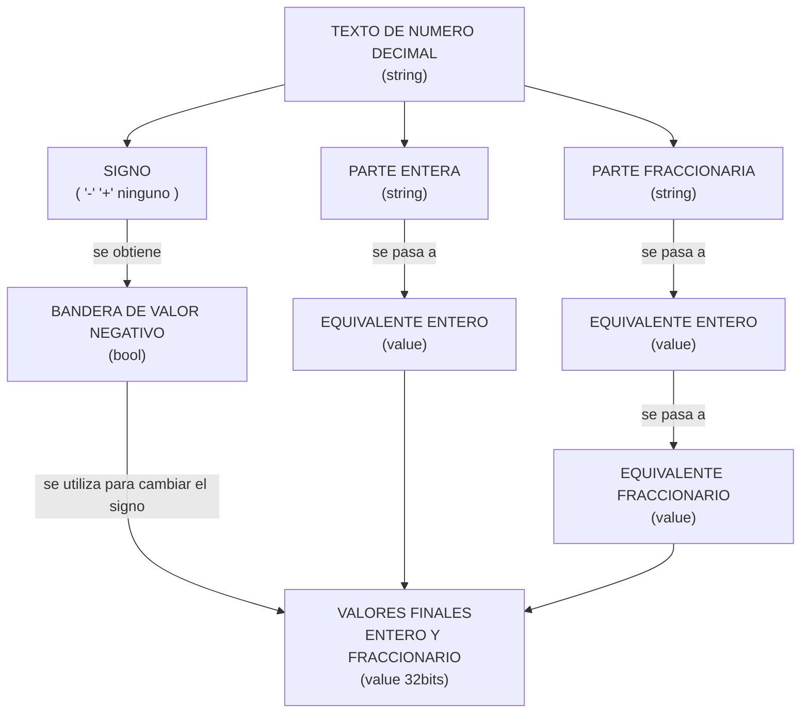

# Relaciones de Dependencias




# Subrutina TODEC y FROMDEC

## TODEC

Convierte un texto decimal a su valor en binario (entero y fraccionario, 2 WORD)



## FROMDEC

El proceso inverso utilizado en la Subrutina FROMDEC, utiliza el mismo diagrama pero a la inversa.


# Algoritmos implementados para el pasaje entre tipos de datos

## Texto deciaml ENTERO --> Equivalente ENTERO

Nos aprovecharemos que podemos leer el texto de izquierda a derecha, digito a digito, por lo que podemos simplificar al algoritmo a simplemente multiplicar por 10 y sumar el valor del digito.

- Se inicializa un registro resultado en 0.
- Se procesa el texto de izquierda a derecha digito a digito:  
Con cada digito, se multiplica el resultado por 10, y se suma el valor del digito  

`resultado = (resultado * 10) + valor(digito)`


Consideraciones:

> Multiplicar un valor por cualquier constante es posible simplemente con sumas consecutivas y un registro auxiliar.  
> Multiplicar `R0` por 10 es posible usando `R1` como auxiliar con la siguiente secuencia:

```
    ADD R1 R0 R0    ;   [R1] = [R0] * 2         osea [R1] = [R0] * 2
    ADD R1 R1 R1    ;   [R1] = [R1] * 2         osea [R1] = [R0] * 4
    ADD R1 R1 R0    ;   [R1] = [R1] + [R0]      osea [R1] = [R0] * 5
    ADD R0 R1 R1    ;   [R0] = [R1] * 2         osea [R0] = [R0] * 10
```

## Equivalente ENTERO --> Texto deciaml ENTERO

Usaremos un algoritmo de conteo de restas sucesivas para obtener el valor de cada digito decimal, de izquierda a derecha.  
Consiste en contar cuantas veces entra la unidad, decena, centena, etc. del digito dentro del equivalente entero.
- Se dispone de un buffer de texto donde almacenar los digitos obtenidos, y de un vector con todas las potencias de $10^n$ necesarias (que corresponden a la posicion del digito que queremos hallar) (por ejemplo un 4 en la 3er posicion corresponde 400 que es 4 veces $10^2$).
- Se itera para cada digito posible, contando cuantas veces se puede restar hasta que el resultado sea negativo, el equivalente entero menos la expresion de potencia del digito actual.  
Cuando el resultado es negativo, la cantidad de veces indica el digito actual, y el resultado anterior al negativo sera nuestro nuevo equivalente entero con el que continuar.


Consideraciones:

> Existe un algoritmo llamado *"Double Dabble"* que utiliza shift y suma para pasar desde una exprecion entera en binario a un formato llamado *"Decimales codificados en Binario" (BCD)*, en el cual cada digito queda codificado en 4 bits, resultando inmediato el pasaje a texto.
> Considerando las limitaciones de la LC3 y la complejidad de implementar el algoritmo, nos decidimos por el metodo de busqueda con restas sicesivas que resulta mas practico de implementar.


## Equivalente ENTERO --> Equivalente FRACCIONARIO

Nos aprovecharemos de que multiplicar un numero fraccionario por 2, nos provee en la parte entera el valor del bit correspondiente a la primer posicion despues de la coma, y los demas bits forman nuestra nueva parte fraccionaria.
- Se inicializa un registro resultado en 0.
- Se prosesa el entero 17 veces, buscando los valores de los 16 bits del resultado, y la 17ma vez se utiliza para redondear.  
Cada iteracion, se multiplica el entero por 2, y se compara si es mayor a 1.0 (osea se le resta 1_000_000_000, *Vea Consideraciones*).  
Si la resta se concreta positiva o cero, encontramos un bit del resultado en 1.
```
    resultado = 0
    mascara = 0x8000
    # while ... :
        entero = entero * 2
        if entero - 1_000_000_000 >= 0:
            resultado = resultado | mascara
            entero = entero - 1_000_000_000
        mascara = mascara >> 1
    # 17ma vez :
    if entero - 1_000_000_000 >= 0:
        resultado = resultado + 1
```

Consideraciones:

> Se utiliza un numero decimal con 9 digitos despues de la coma, ya que la mayor potencia de $10^n$ que se puede representar con signo en 32 bits es 1_000_000_000. Y ademas, por que si utilizaramos 16 bits, la mayor potencia corresponderia a 10_000 lo que nos permite unicamente 4 digitos, que no nos permitirian suficiente precision y redondeo para representaciones en Q3.12, entre otras.  
> Por lo tanto, se espera siempre que el equivalente entero sea un numero donde el 9no digito decimal sea el primero despues de la coma, (el 8vo el siguiente, ...), lo que nos da como ejemplo las siguientes representaciones:

```
    0.141_592_653_589   ->  141_592_653     (se descarta el excedente)
    0.5                 ->  500_000_000
    0.001_23            ->  001_230_000
    El valor 1_000_000_000 corresponde a 1.0 (utilizado para obtener la parte entera en el algoritmo).
```

> Como utilizamos 32 bits (osea 2 registros), es necesario implementar un metodo para multiplicar por 2 (desplazar a la izquierda), y sumar valores de multiples registros de ancho.  


## Equivalente FRACCIONARIO --> Equivalente ENTERO

Para volver desde equivalente fraccionario a equivalente entero, simplemente tenemos que sumar el valor asociado al bit del fraccionario, en un registro resultado. El valor asociado a cada bit puede estar en memoria (tener un vector con todas las potencias de $2^n$ con $n$ negativo) o las podemos calcular en cada iteracion.  
Se decidio calcularlo utilizando un metodo con 3 registros, donde se carga en esos 48 bits el valor 1_000_000_000, y se corre hacia la izquierda en cada iteracion, dandonos en los 32 bits de la izquierda el valor asociado actual (con $n=-16$ hasta $n=-1$).
- Se inizializan los registros resultado (32 bits) en 0.
- Se procesa bit a bit de derecha a izquierda, utilizando una mascara, el fraccionario.  
Si el bit del fraccionario fue 1, se suma el valor asociado actual al resultado.

```
    resultado = 0
    mascara = 1
    asociado_actual = 2**-16
    if fraccionario & mascara:
        resultado = resultado + asociado_actual
    mascara = mascara << 1
    asociado_actual = asociado_actual * 2
```

Consideraciones:
> Se utilizan 32 bits ya que tomaremos 9 digitos decimales despues de la coma, con la misma representacion que el el Algoritmo de ENTERO --> FRACCIONARIO.  
> Para el calculo de las potencias de $2^n$ se trabaja con la representacion dicha, y como resulta mucho mas inmediato multiplicar por 2, que dividir, simplemente representamos $1.0 * 2^{-16}$ lo que nos da 48 bits donde la representacion 1_000_000_000 queda en los 2 registros derechos. Ya con este numero podemos multiplicar por 2 (osea despalzar a la izquierda) para obtener las potencias de $2^n$ en nuestra representacion en los 2 registros izquierdos.
